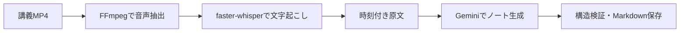

# elearning-converter

[](https://opensource.org/licenses/MIT)

**講義MP4の音声を、時刻付き原文と復習用Markdownへ変換するWindows向けPython CLI。**

長い講義を見返す手間を減らし、説明・手順・具体例を原文と照合できる授業ノートを目指す個人開発プロジェクトです。音声処理はローカルで行い、ノート生成にはGemini APIを使います。

[操作マニュアル](docs/guides/user-manual.md) · [設計](docs/design.md) · [検証記録](docs/verification.md) · [未解決問題](docs/issues/known-issues.md)

## 出力のイメージ

次は**架空の内容による期待する書式見本**です。実教材・実APIの生成結果ではありません。

> 箱は外から中身が見えないため、開けて確認する手間がかかる。**ラベル**は中身を示す名前で、例えば文具を入れた箱に「文具」と書くと、開けずに用途が分かる [00:00:01]
>
> 同じ用途の箱をまとめると、探す場所を絞れる。ただし中身を入れ替えたら、ラベルも更新する必要がある [00:00:12]

本文には根拠時刻、不明箇所には確認事項を付けます。[見本の全文](docs/note-example.md)と[手順・具体例の情報保持の見本](docs/note-fidelity-example.md)も参照できます。

## 処理の流れと実装上の工夫



- **音声をローカルで処理**：FFmpegで16 kHzモノラルPCMへ変換し、NumPy配列としてfaster-whisperへ渡します。MP4/WAVはAPIに送りません。
- **生成結果を検証して保存**：JSON Schemaとローカル検査を組み合わせ、不完全応答を記事として採用しません。上書き保護、原文救済、一時ファイルからの置換を実装しています。
- **品質改善を工程に分離**：実験的な台帳方式では、情報抽出・独立照合・章構成・本文生成・境界照合を分け、根拠IDと本文の対応を検査します。段落・手順・表・コードはPythonで整形します。

技術構成はPython 3.11以降、FFmpeg/ffprobe、faster-whisper、NumPy、Google Gen AI SDK。CLIとローカル保存を中心に構成しています。[設計の詳細](docs/design.md)

## 実装・検証状況

| 項目 | 状況 |
| --- | --- |
| 文字起こし・通常のノート生成・既存原文からの再生成 | 実装済み。認識・生成内容は原音声との照合が必要 |
| 独立照合・限定修正を行う`--quality-check` | 実装済み。モデルの判定は品質の保証ではない |
| 台帳方式の`--note-pipeline` | 実装済み・改善中。2026-11-04の実教材3本は形式不正・情報未掲載により記事未確定 |
| オフライン検証 | 74件成功の記録あり。失敗処理、応答構造、保存保護等を確認。実生成品質の実証とは区別 |

現在の重点課題は、台帳応答の安定化、必須情報の本文への反映、不明語・数式に対する判定の改善です。[未解決問題と次の検証](docs/issues/known-issues.md)にまとめています。映像・字幕・スライド解析、話者分離、GUI、一括処理は対象外です。

## クイックスタート

Windows 11、Python 3.11以降、PATHに登録済みのFFmpegとffprobeを用意し、PowerShellで実行します。初回のWhisperモデル取得にはネットワーク接続が必要な場合があります。

```powershell
git clone https://github.com/ftmnititi811-max/elearning-converter.git
cd elearning-converter
py -m venv .venv
.\.venv\Scripts\Activate.ps1
python -m pip install -e .
```

まずAPIキー不要で、時刻付き原文を作成できます。

```powershell
elconv "C:\講義 資料\授業.mp4" --no-article --output-dir "C:\復習 ノート"
```

Geminiでノートを作る場合は、[.env.example](.env.example)を参考にプロジェクト直下の`.env`へキーを設定します。`.env`はGit管理外です。実際のキーをコミットしないでください。

```powershell
elconv "C:\講義 資料\授業.mp4" --output-dir "C:\復習 ノート"
```

成功すると`授業.md`と`授業.transcript.md`をUTF-8で保存します。既存ファイルは`--overwrite`を付けた場合のみ置換します。仮想環境を有効にできない場合の起動方法、環境変数でのキー設定、既存原文の利用は[操作マニュアル](docs/guides/user-manual.md)を参照してください。

**利用前に確認すること**：教材の加工・API送信が許可されていること、使用モデルの料金・クォータを確認してください。通常方式は文字起こし、品質確認方式は派生したノート等も送信します。CLIは料金上限を保証しません。出力は復習用下書きとして原音声と照合してください。

## 詳細情報

- [操作マニュアル](docs/guides/user-manual.md)：モード選択、全オプション、出力、失敗時の動作、費用、トラブル対応
- [要件](docs/requirements.md)・[仕様](docs/spec.md)・[設計](docs/design.md)：目的、受入基準、実装の責任分担
- [検証記録](docs/verification.md)・[実教材テスト手順](docs/user-material-test.md)：確認済みの範囲と再評価方法
- [開発の進め方](docs/workflows/development-workflow.md)・[文書案内](docs/guides/documentation-map.md)：開発手順と参照先
